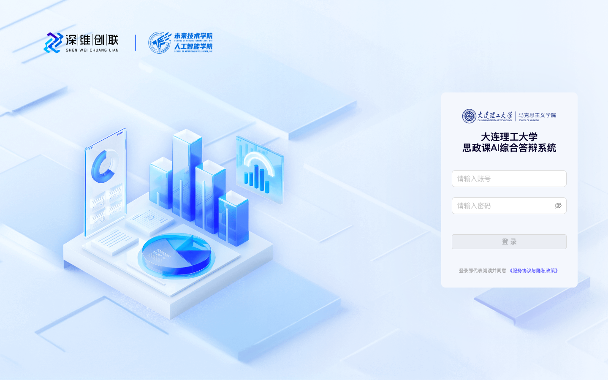
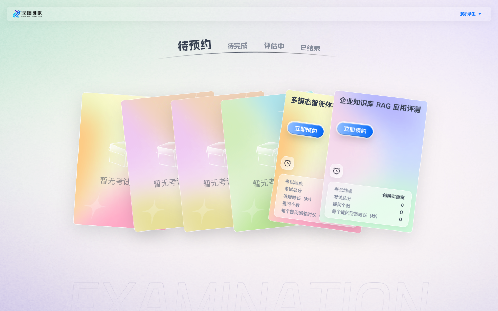
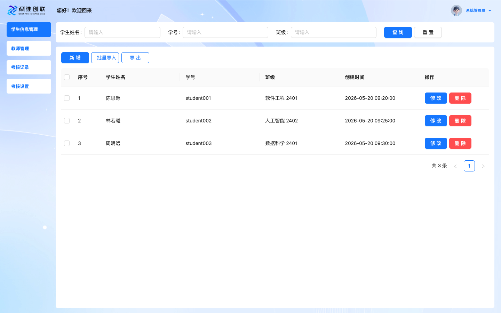
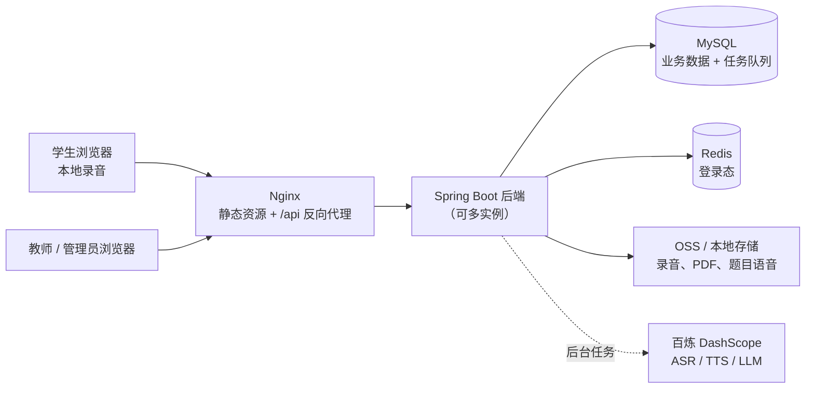
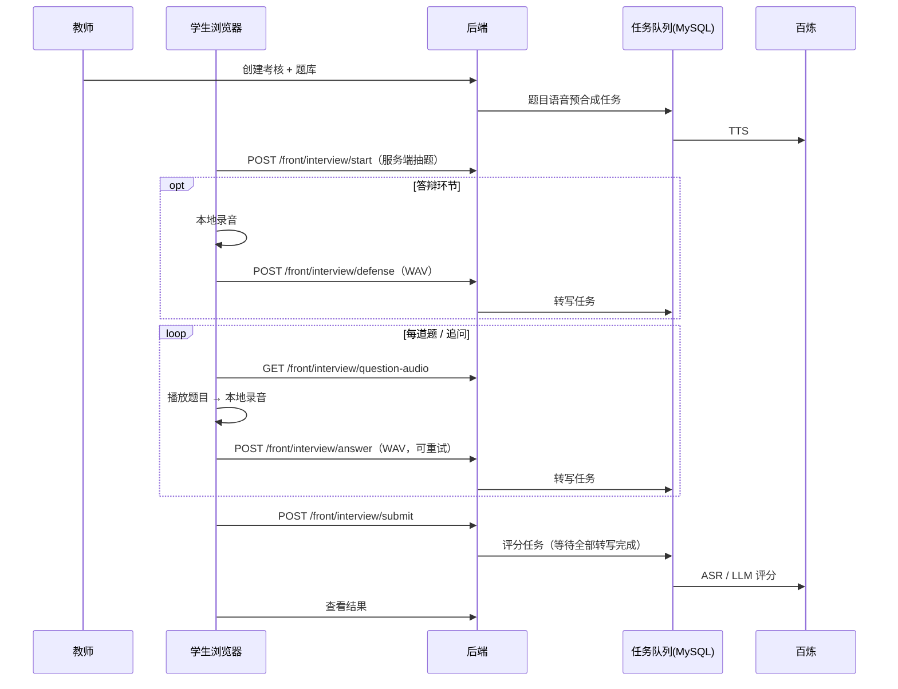

# AI Interview System

<p align="center">
  
  
  
  
  
  
</p>

<p align="center">
  <a href="#软件预览">软件预览</a> ·
  <a href="#核心能力">核心能力</a> ·
  <a href="#系统架构">系统架构</a> ·
  <a href="#本地运行">本地运行</a> ·
  <a href="#常见问题">常见问题</a>
</p>

面向高校课程答辩、项目验收和能力测评场景的 AI 面试系统。系统支持教师创建考核与预制题库、学生在线预约、随机抽题语音面试、预制追问、PDF 材料上传、自动转写评分与结果分析，帮助教学团队把分散的答辩流程沉淀为可追踪、可复盘、可量化的数字化工作流。

> 本项目为前后端分离架构，前端位于 `defense-system`，后端位于 `defense-assessment`。

## 软件预览

| 登录页 | 学生端考核列表 |
| --- | --- |
|  |  |

| 管理端学生信息管理 |
| --- |
|  |

## 核心能力

- **多角色工作台**：学生、教师、管理员三类角色，按角色动态加载工作台与权限路由。
- **考核与题库管理**：教师创建考核时维护题库（题目、考核维度、参考答案、预制追问），设置每位学生的抽题数、答辩 / 作答时长、评分标准和参与学生；可用 AI 根据考核信息和 PDF 材料生成题库草稿，审核后保存。
- **随机抽题**：学生开始面试时按考核维度均衡地随机抽题，抽题结果持久化，刷新或重连后保持不变；重考会重新抽题。
- **稳定的语音面试**：题目语音在教师保存题库后预先合成；学生在浏览器本地录音，每答完一题用普通 HTTP 请求上传。面试进度全部保存在服务端，所有接口幂等、可安全重试，断网 / 刷新后自动恢复。
- **异步转写与评分**：语音转写（qwen3-asr-flash）与 AI 评分（qwen3.6-plus）在持久化任务队列中执行，带并发上限、失败退避重试和多实例抢占。
- **学生在线预约**：学生可查看待预约、待完成、评估中、已结束的考核任务。
- **结果分析**：总分、维度得分、答题明细（含录音回放）、追问记录、亮点 / 不足 / 改进建议；教师可改分、重考、重新评分、导出。

架构设计与高并发改造说明见 [docs/ARCHITECTURE.md](docs/ARCHITECTURE.md)。

## 技术栈

### 前端

- Vue 3 / Vue Router 4 / Pinia
- Ant Design Vue / Tailwind CSS / ECharts
- Axios
- Web Audio（AudioWorklet）本地录音，16kHz 单声道 WAV

### 后端

- Java 21 / Spring Boot 3.5（Spring Web，无 WebSocket）
- Sa-Token（登录态存 Redis，支持多实例）
- MyBatis-Plus / HikariCP
- Redis / JetCache
- OkHttp（调用百炼）
- Aliyun OSS SDK（或本地磁盘存储）
- SpringDoc OpenAPI

### 基础设施

- **MySQL**：业务数据，以及面试进度、抽题结果、后台任务队列（`async_task`）。
- **Redis**：登录态与缓存。
- **文件存储**：阿里云 OSS，未配置 OSS 时自动使用本地磁盘（私有化部署 / 开发测试）。
- **DashScope / Qwen**：qwen3.6-plus（评分、生成题库草稿）、qwen3-asr-flash（语音转写）、qwen3-tts-flash（题目播报）、qwen-long（PDF 材料解析）。

## 系统架构



请求链路（学生答题）只做"存文件 + 写数据库"，不调用大模型；语音转写、评分、语音合成都由后台任务完成。

## 目录结构

```text
.
├── defense-assessment/        # Spring Boot 后端
│   ├── src/main/java/.../application/service/interview/  # 面试流程、题库、抽题、评分
│   ├── src/main/java/.../application/task/               # 持久化后台任务队列
│   ├── src/main/java/.../infrastructure/storage/         # OSS / 本地存储
│   └── src/main/resources/     # application 配置
├── defense-system/             # Vue 3 前端
│   ├── src/views/studentDashboard/interview/  # 学生面试页
│   ├── src/composables/useAudioRecorder.ts    # 本地录音
│   └── src/api/                # 前端 API 封装
├── deploy/                     # Docker Compose 部署（MySQL + Redis + 后端 + Nginx）
├── scripts/                    # 本地启动脚本、建表脚本、数据库迁移
├── docs/                       # 架构文档与截图
├── .env.example                # 本地环境变量模板
└── README.md
```

## 本地运行

### 环境要求

- Node.js 18+、npm 9+
- Java 21
- MySQL 8+、Redis 6+
- DashScope API Key（需开通 qwen3.6-plus、qwen3-asr-flash、qwen3-tts-flash）
- 可选：阿里云 OSS（不配置则使用本地磁盘）

### 1. 配置环境变量

```bash
cp .env.example .env.local
```

至少填写 `DASHSCOPE_API_KEY`、`DB_JDBC_URL`、`DB_USERNAME`、`DB_PASSWORD`。其余配置项见 `.env.example` 中的说明。

> `.env.local` 包含 API Key、数据库密码、对象存储密钥等敏感信息，已经被 Git 忽略，请勿提交。

### 2. 初始化数据库

```bash
mysql -uroot -p -e "CREATE DATABASE defense_test DEFAULT CHARACTER SET utf8mb4 COLLATE utf8mb4_unicode_ci"
mysql -uroot -p defense_test < scripts/local-db-schema.sql
mysql -uroot -p defense_test < scripts/local-db-seed.sql   # 测试账号 admin/admin123、teacher/teacher123、student/student123
```

从旧版本（WebSocket 实时出题）升级已有数据库：先备份，再执行 `scripts/migrations/V2__prebuilt_question_interview.sql`。旧考核没有题库，需要老师补充题库后再开放给学生。

之后再执行 `scripts/migrations/V3__teacher_review.sql`（教师按维度复核评分）。

### 3. 启动

```bash
./scripts/start-backend.sh      # http://localhost:8081 ，接口文档 /swagger-ui.html
npm --prefix defense-system install
./scripts/start-frontend.sh     # http://localhost:3004
```

本地开发未配置 OSS 时，`.env.local` 中设置 `STORAGE_PUBLIC_URL_PREFIX='/dev-api'`，录音和 PDF 会保存在 `defense-assessment/data/storage`。

## 部署

`deploy/` 目录提供单机 Docker Compose 部署：

```bash
./deploy/deploy.sh                 # 构建后端 jar 与前端（staging 模式，API 前缀 /api）到 deploy/app
cd deploy && cp .env.example .env  # 修改密码、密钥，填写 DASHSCOPE_API_KEY
docker compose up -d               # 默认访问 http://<服务器>:18100
```

数据库首次启动时自动建表并写入测试账号，**上线前请修改或删除测试账号**。

横向扩容：后端可以部署多个实例（登录态在 Redis，后台任务通过数据库抢占，互不重复执行），此时文件存储必须使用 OSS 或共享目录。也可以用 `TASK_WORKER_TYPES` 让部分实例只处理特定类型的后台任务。

## 配置说明

### AI 模型与并发

| 配置项 | 说明 |
| --- | --- |
| `DASHSCOPE_API_KEY` | 百炼 API Key |
| `DASHSCOPE_TEXT_MODEL` | 评分 / 出题模型，默认 `qwen3.6-plus` |
| `DASHSCOPE_ASR_MODEL` | 语音转写模型，默认 `qwen3-asr-flash` |
| `DASHSCOPE_TTS_MODEL` / `DASHSCOPE_TTS_VOICE` | 题目播报模型与音色，默认 `qwen3-tts-flash` / `Cherry` |
| `DASHSCOPE_CONCURRENCY_LLM` / `_ASR` / `_TTS` | 单实例同时在途的大模型请求上限，按账号配额调整 |
| `TASK_CONCURRENCY_ASR` / `_ANALYSIS` / `_TTS` | 每类后台任务的并发线程数（三类转写任务合计不要超过 ASR 上限） |
| `TASK_WORKER_ENABLED` / `TASK_WORKER_TYPES` | 是否在本实例执行后台任务 / 只执行哪些类型 |

### 数据库与 Web

| 配置项 | 说明 |
| --- | --- |
| `DB_JDBC_URL` / `DB_USERNAME` / `DB_PASSWORD` | MySQL 连接 |
| `DB_POOL_SIZE` | 连接池大小，默认 30 |
| `TOMCAT_MAX_THREADS` | Web 线程数，默认 200 |
| `REDIS_HOST` / `REDIS_PORT` / `REDIS_PASSWORD` / `JETCACHE_REDIS_URI` | Redis 连接 |

### 文件存储

| 配置项 | 说明 |
| --- | --- |
| `STORAGE_TYPE` | `auto`（默认，配置了 OSS 密钥就用 OSS）/ `oss` / `local` |
| `ALIYUN_OSS_*` | OSS Endpoint、AccessKey、Bucket |
| `STORAGE_LOCAL_DIR` | 本地存储目录 |
| `STORAGE_PUBLIC_URL_PREFIX` | 浏览器访问后端的 URL 前缀（如 `/dev-api`、`/api`），用于生成本地文件的签名直链 |
| `STORAGE_LOCAL_SECRET` | 本地文件直链的签名密钥，生产环境务必修改 |

## 面试流程



## 测试

```bash
cd defense-assessment && ./mvnw test        # 单元测试：抽题、面试状态机、WAV 处理、题库校验等
cd defense-system && npx vue-cli-service build
```

## 常见问题

### 1. 接口提示数据库连接失败

确认 MySQL 可连通、`DB_JDBC_URL` 正确，且后端是在加载了 `.env.local` 的情况下启动（推荐用 `scripts/start-backend.sh`）。

### 2. 题目没有声音

题目语音在保存题库后由后台任务预生成，教师端列表的 `audioReady` 表示是否已生成；未生成时学生端会现场合成，再失败则使用浏览器朗读，最差直接显示文字，不会卡住面试。请检查 API Key 是否开通 qwen3-tts-flash。

### 3. 提交后一直"评估中"

评分在后台任务中执行，先等所有录音转写完成再评分。查看 `async_task` 表中对应记录的 `status`、`attempts`、`last_error`；失败超过重试次数后教师可在学习记录中手动重新评分（`/backend/study-record/reanalyze`）。

### 4. 录音失败

浏览器需要允许麦克风权限，且页面必须通过 HTTPS 或 localhost 访问（浏览器只在安全上下文开放麦克风）。

## 开发建议

- 不要提交 `.env.local`、数据库密码、API Key、OSS 密钥或 SSH 密码。
- 学生答题链路上不要引入同步的大模型调用；需要 AI 的地方放进 `async_task` 任务。
- 新增后台任务：实现 `TaskHandler` 并注册为 Bean，处理器必须幂等。
- 日志中避免打印学生语音原文、密码、Token、API Key 等敏感信息。

## 许可证

本项目基于 MIT License 开源，详见 [LICENSE](LICENSE)。
